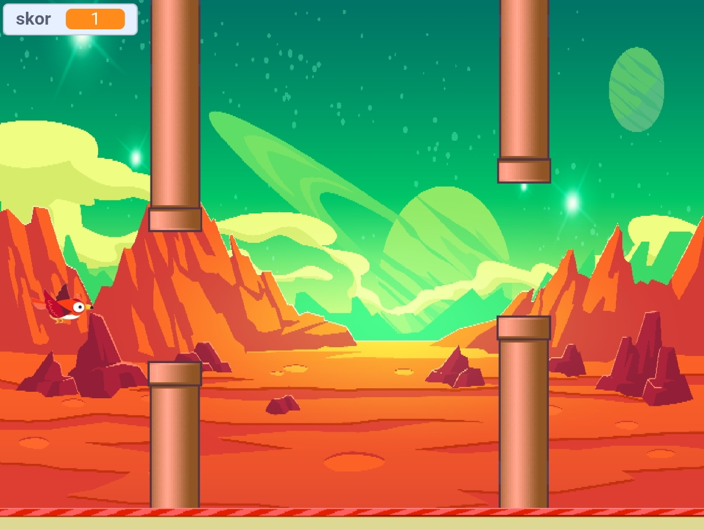

# 🐦 Flappy Bird – Game Scratch

Game **Flappy Bird** yang dibuat menggunakan **Scratch** dengan tema planet Mars bergaya pixel art. Kendalikan burung merah, lewati celah di antara pipa, dan kumpulkan skor setinggi mungkin!

🎮 **Main sekarang:** [https://burung-radit.netlify.app](https://burung-radit.netlify.app)

---

## 📸 Screenshot

| Menu Awal | Gameplay | Game Over |
|:---:|:---:|:---:|
|  |  |  |

---

## 📖 Tentang Game

Flappy Bird adalah game arcade sederhana namun menantang. Pemain mengendalikan seekor burung yang terus terbang ke depan. Tugas pemain adalah menjaga burung tetap di udara dan melewati celah di antara pipa atas dan bawah tanpa menabraknya.

Game ini dibuat sebagai **tugas sekolah** (Bu Diena – kelas PPLG 1) untuk belajar logika pemrograman visual menggunakan Scratch.

---

## ✨ Fitur

- 🖼️ **Menu awal** dengan tombol **START**
- 🐦 Burung yang dapat dikendalikan pemain
- 🟫 Pipa atas dan bawah yang bergerak dengan celah yang harus dilewati
- 🏆 **Sistem skor** (variabel `skor`) yang bertambah setiap berhasil melewati pipa
- 💥 Deteksi tabrakan dengan pipa dan tanah
- ☠️ Layar **Game Over** dengan tombol **PLAY** (main lagi) dan **EXIT**
- 🌌 Latar belakang bertema planet Mars bergaya pixel art

---

## 🕹️ Cara Bermain

1. Buka game melalui link di atas.
2. Klik tombol **START**.
3. Buat burung terbang ke atas dengan kontrol yang tersedia di game (klik / tekan tombol), lalu biarkan burung jatuh secara alami karena gravitasi.
4. Lewati celah di antara pipa untuk mendapatkan **+1 skor**.
5. Hindari menabrak pipa atau tanah. Jika menabrak, game berakhir.
6. Klik **PLAY** untuk mencoba lagi atau **EXIT** untuk keluar.

---

## 🧠 Konsep Pemrograman yang Digunakan

- **Variabel** – menyimpan dan menampilkan skor (`skor`)
- **Perulangan (loop)** – menjalankan game terus-menerus (`forever`)
- **Percabangan (if/else)** – mengecek tabrakan dan kondisi game over
- **Sensing** – mendeteksi sentuhan burung dengan pipa dan tanah
- **Event / Broadcast** – berpindah antar layar (menu → game → game over)
- **Clone** – membuat pipa secara berulang dengan posisi acak
- **Gerak & gravitasi** – simulasi burung jatuh dan melompat

---

## 🛠️ Teknologi

| Komponen | Keterangan |
|---|---|
| Pembuatan game | [Scratch](https://scratch.mit.edu/) |
| Konversi ke web | [TurboWarp Packager](https://packager.turbowarp.org/) |
| Hosting | [Netlify](https://www.netlify.com/) |

---

## 📂 Struktur Project

```
.
├── index.html        # Game hasil package TurboWarp (siap dijalankan di browser)
├── README.md         # Dokumentasi project
└── screenshots/      # Gambar tampilan game
    ├── menu.jpeg
    ├── gameplay.jpeg
    └── game-over.jpeg
```

## 👤 Pembuat

- **Nama:** Radit
- **Kelas:** PPLG 1
- **Tugas:** Bu Diena

---

